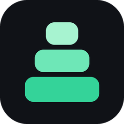
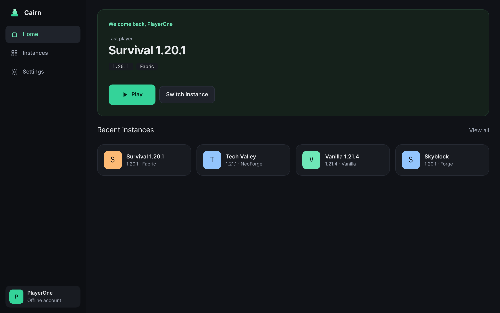
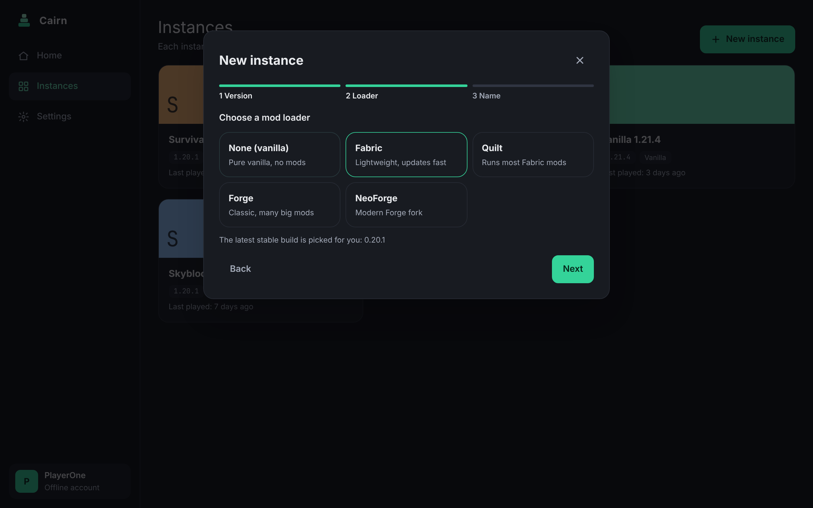
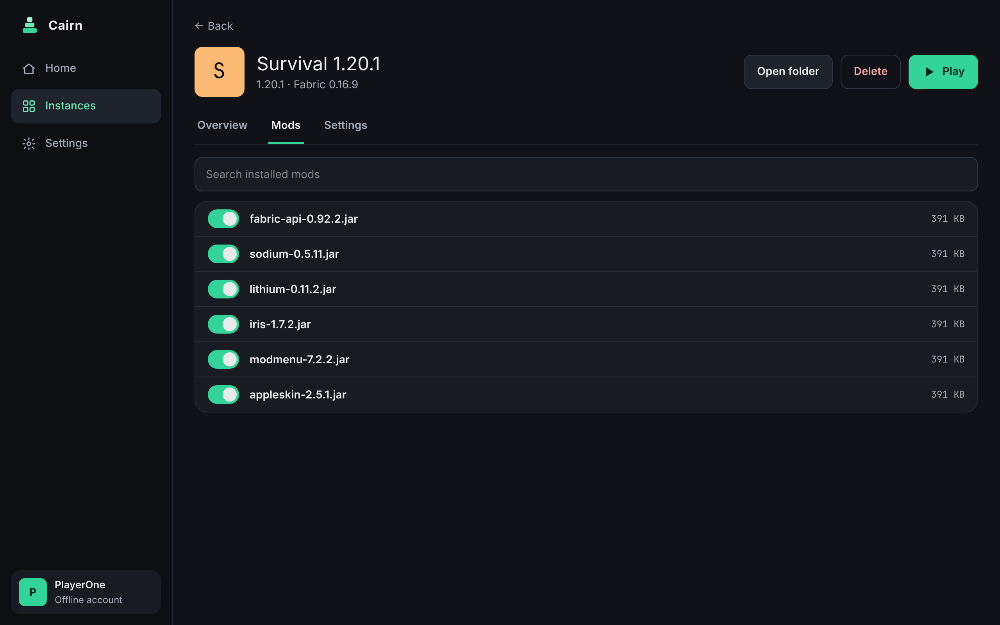

<p align="center">
  
</p>

<h1 align="center">Cairn</h1>

<p align="center">A friendly launcher for <b>Minecraft: Java Edition</b> on Windows, macOS and Linux.<br>
Pick a version, pick a mod loader, press Play — Cairn downloads the game, the loader and the right Java for you.</p>

<p align="center"><a href="README.zh-CN.md">简体中文</a></p>



## Features

Available now (0.1):

- **Three-step instances** — choose a version (snapshots optional), a mod loader (Fabric, Quilt, Forge or NeoForge, latest stable build picked for you) and a name. Everything else is automatic.
- **Java handled for you** — finds the Javas you already have and downloads the right Eclipse Temurin runtime when needed.
- **Fast, safe downloads** — parallel, resumable, every file checked against its SHA-1.
- **Microsoft and offline accounts** — sign in with a short device code; tokens stay in your system keychain.
- **Mod list per instance** — switch mods on and off without deleting them.
- **Crash help** — if the game closes unexpectedly you see its last 50 log lines and can open the log folder.
- **English and 简体中文**, light and dark themes, five accent colours, full keyboard support.
- **A command line too** — `cairn instance create`, `cairn instance launch`, …
- **Small** — about 10 MB to install.

In development:

- **Mod auto-match** — move a whole mod set to another Minecraft version: compatible builds found on Modrinth and CurseForge, dependencies added, conflicts flagged, original instance untouched.
- **World transfer** — copy worlds between instances and computers with automatic backups and a guard against unsafe downgrades.
- **Discover** — browse and install mods, resource packs and shaders in one click.

| | |
|---|---|
|  |  |

## Install

Download the installer for your system from the [latest release](https://github.com/Yokiwa/cairn/releases/latest):

| System | File |
|---|---|
| Windows 10/11 | `Cairn_x.y.z_x64-setup.exe` or `.msi` |
| macOS (Apple silicon / Intel) | `Cairn_x.y.z_aarch64.dmg` / `Cairn_x.y.z_x64.dmg` |
| Linux | `.AppImage` (any distro) or `.deb` (Debian, Ubuntu) |

Cairn isn't code-signed yet, so your system will ask before opening it the first time:

- **Windows:** on "Windows protected your PC", click **More info → Run anyway**.
- **macOS:** right-click (or Control-click) Cairn in Applications, choose **Open**, then **Open** again.
- **Linux AppImage:** `chmod +x Cairn_*.AppImage`, then run it.

You need a Microsoft account that owns Minecraft: Java Edition to play online.

## Build from source

You need Rust (stable), Node.js 22 with pnpm 10, and on Linux the WebKitGTK packages:

```bash
sudo apt-get install -y libwebkit2gtk-4.1-dev libappindicator3-dev librsvg2-dev patchelf
```

```bash
pnpm -C ui install
```

```bash
node ui/node_modules/@tauri-apps/cli/tauri.js dev
```

`tauri.js build` produces installers in `target/release/bundle/`. The command-line launcher is `cargo run -p cairn-cli -- --help`. See [CONTRIBUTING.md](CONTRIBUTING.md) for tests and project layout.

## Data and privacy

Cairn keeps everything in one folder: `%APPDATA%\Cairn` on Windows, `~/Library/Application Support/Cairn` on macOS, `~/.local/share/cairn` on Linux (override with `CAIRN_HOME`). Sign-in tokens live only in the system keychain. Cairn collects no usage data.

## License

[GPL-3.0](LICENSE). Cairn is not an official Minecraft product and is not approved by or associated with Mojang or Microsoft. It does not distribute game files; they are downloaded from Mojang's servers, and you need to own the game.
