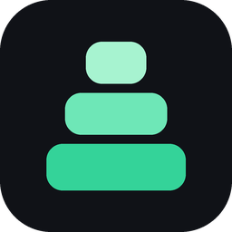
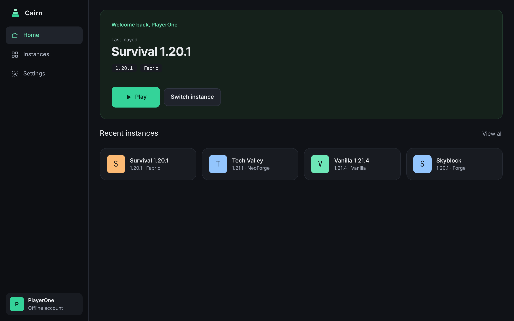
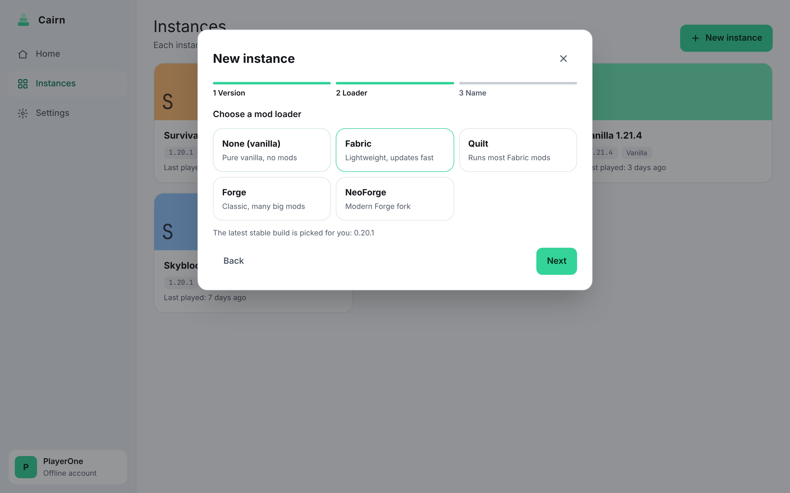
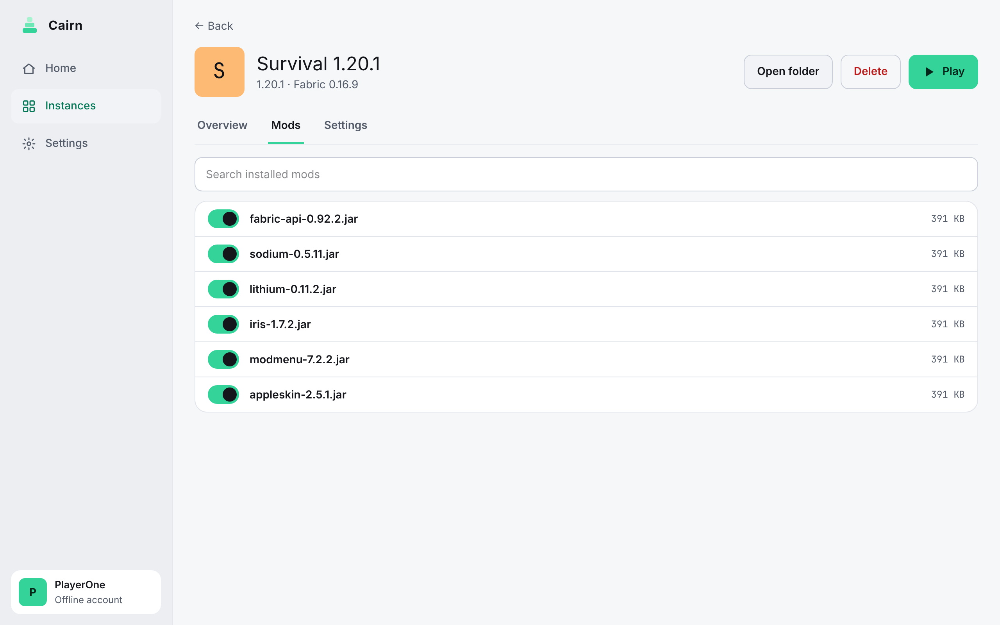

<p align="center">
  
</p>

<h1 align="center">Cairn</h1>

<p align="center">好上手的 <b>Minecraft: Java 版</b>启动器，支持 Windows、macOS 和 Linux。<br>
选版本、选加载器、点开始游戏——游戏本体、模组加载器和合适的 Java 都由 Cairn 自动下载。</p>

<p align="center"><a href="README.md">English</a></p>



## 功能

现在可用（0.1）：

- **三步建实例**：选版本（可显示快照版）、选模组加载器（Fabric、Quilt、Forge、NeoForge，自动选最新稳定版）、起名字，其余全自动
- **Java 不用操心**：自动找到电脑上已装的 Java，缺了就下载合适的 Eclipse Temurin
- **下载快又稳**：多线程、断点续传，每个文件都做 SHA-1 校验
- **微软账号和离线账号**：用一个短代码在浏览器里登录；登录凭证只存在系统钥匙串里
- **实例模组列表**：一键启用或停用模组，不用删文件
- **崩溃提示**：游戏意外退出时显示最后 50 行日志，并能打开日志文件夹
- **中文和英文界面**，浅色和深色主题，5 种强调色，全部功能都能用键盘操作
- **命令行版**：`cairn instance create`、`cairn instance launch` 等
- **体积小**：安装包约 10 MB

开发中：

- **模组自动适配**：把整套模组换到另一个 MC 版本。自动在 Modrinth 和 CurseForge 上找兼容版本、补前置、查冲突，原实例不动
- **存档转移**：在实例之间、电脑之间转移存档，自动备份，并拦住危险的降级
- **发现**：一键浏览和安装模组、资源包、光影

| | |
|---|---|
|  |  |

## 安装

在[最新版本](https://github.com/Yokiwa/cairn/releases/latest)页面下载对应系统的安装包：

| 系统 | 文件 |
|---|---|
| Windows 10/11 | `Cairn_x.y.z_x64-setup.exe` 或 `.msi` |
| macOS（Apple 芯片 / Intel） | `Cairn_x.y.z_aarch64.dmg` / `Cairn_x.y.z_x64.dmg` |
| Linux | `.AppImage`（任何发行版）或 `.deb`（Debian、Ubuntu） |

Cairn 还没有做代码签名，所以第一次打开时系统会拦一下：

- **Windows**：弹出“Windows 已保护你的电脑”时，点 **更多信息 → 仍要运行**
- **macOS**：在“应用程序”里右键（或按住 Control 点）Cairn，选 **打开**，再点一次 **打开**
- **Linux AppImage**：先 `chmod +x Cairn_*.AppImage`，再运行

联网游玩需要一个拥有 Minecraft: Java 版的微软账号。

## 从源码构建

需要 Rust（stable）、Node.js 22 和 pnpm 10；Linux 上还要装 WebKitGTK：

```bash
sudo apt-get install -y libwebkit2gtk-4.1-dev libappindicator3-dev librsvg2-dev patchelf
```

```bash
pnpm -C ui install
```

```bash
node ui/node_modules/@tauri-apps/cli/tauri.js dev
```

用 `tauri.js build` 打包，安装包在 `target/release/bundle/`。命令行版：`cargo run -p cairn-cli -- --help`。测试和目录结构见 [CONTRIBUTING.md](CONTRIBUTING.md)。

## 数据和隐私

所有数据都在一个文件夹里：Windows 是 `%APPDATA%\Cairn`，macOS 是 `~/Library/Application Support/Cairn`，Linux 是 `~/.local/share/cairn`（可以用环境变量 `CAIRN_HOME` 改）。登录凭证只存在系统钥匙串里。Cairn 不收集任何使用数据。

## 许可证

[GPL-3.0](LICENSE)。Cairn 不是 Minecraft 官方产品，未经 Mojang 或 Microsoft 认可，也与它们无关。Cairn 不分发游戏文件，游戏文件都从 Mojang 的服务器下载，你需要拥有正版游戏。
